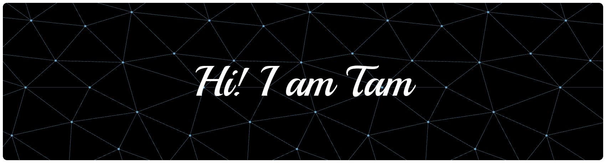

## About Me
Hello! I'm a third-year university student with a strong passion for technology and coding. I enjoy exploring new technologies to improve my skills. I also love sharing knowledge and collaborating with others to grow together. My goal is to keep learning and contribute to meaningful tech projects.

---

## GitHub Stats

---

## Tools & Technologies

### **Languages**

### **Technologies**

### **Tools**

---

## Connect with me
- **Email:** [noe28092006@gmail.com](mailto:noe28092006@gmail.com)

---

Thank you for visiting my profile. Please feel free to explore my projects or contact me for collaboration opportunities.

